# 📸 Awesome Automated Cross-Browser Screenshot Testing

  

  
  
  
  
  
  
  

---

## 🌟 Overview & Key Concepts

Welcome to the definitive, curated ecosystem directory for **Automated Cross-Browser Screenshot Testing**, **Visual Regression Testing (VRT)**, **Pixel Diffing**, and **Automated UI Validation**. 

Whether you are a frontend developer verifying responsive UI layouts across Chrome, Safari, Edge, and Firefox, or a QA/DevOps engineer integrating visual diff gates into CI/CD pipelines (GitHub Actions, GitLab CI, Jenkins), this guide collects the industry's top commercial SaaS platforms and premier open-source frameworks.

### 🎯 Core Capabilities Tracked:
- 🌐 **Cross-Browser & Device Rendering**: Chromium, WebKit, Gecko, and mobile viewport emulation.
- 🔍 **Visual Regression & Pixel Diffing**: Automated snapshot comparison against approved visual baselines.
- 🧩 **Component-Level VRT**: Native integrations with Storybook, Ladle, and Figma design tokens.
- ⚡ **CI/CD Integration**: Headless visual checks blocking unintended CSS and layout regressions before pull requests merge.

---

## 📑 Table of Contents
- [📊 Sector Overview & Market Dynamics](#-sector-overview--market-dynamics)
- [☁️ SaaS / Hosted Platforms](#️-saas--hosted-platforms)
- [🛠️ Open-Source GitHub Projects](#️-open-source-github-projects)
- [🤝 How to Contribute](#-how-to-contribute)
- [💖 Support & Sponsorship](#-support--sponsorship)
- [📈 Star History](#-star-history)
- [📜 Disclaimer](#-disclaimer)

---

## 📊 Sector Overview & Market Dynamics

The global cross-browser and automated software testing sector is estimated at **$2.8B to $24.2B+** in 2025–2026 (spanning dedicated cross-browser testing clouds up to the broader test automation market) with double-digit compound annual growth rates (~10.5%–17%). 

The market is **moderately concentrated at the infrastructure layer**—anchored by dominant cloud test grid leaders like BrowserStack, SmartBear, and Sauce Labs—yet remains **fragmented and competitive across specialized niches** like developer screenshot APIs, visual AI, and change-monitoring tools alongside widespread open-source adoption.

---

## ☁️ SaaS / Hosted Platforms

| 🏢 Platform | 💰 Scale (Valuation / Revenue) | 🏷️ Starting Tier Pricing | 🎁 Free Tier / Trial Limits | 📝 Description |
| :--- | :--- | :--- | :--- | :--- |
| **[BrowserStack Screenshots (Percy)](https://percy.io/)** | ~$4.0B Valuation / ~$230M ARR | $199/month (Desktop plan, 10,000 screenshots/month) | Free Plan: 5,000 screenshots/month forever (unlimited users & projects) | Visual testing platform capturing DOM snapshots across browsers with AI noise reduction. |
| **[CrossBrowserTesting Screenshots](https://smartbear.com/product/crossbrowsertesting/)** | SmartBear ~$1.8B–$2.0B Valuation / ~$150M+ ARR | $39/month (BitBar Live Testing) / $177/month (Automated) | 14-day free trial (full cloud cross-browser testing & execution features) | SmartBear's visual regression and cloud testing platform with side-by-side & onion-skin diffing. |
| **[Screener.io](https://screener.io/)** | Sauce Labs ~$600M+ Valuation / ~$90M+ ARR | $39/month (Live Testing) / $149/month (Virtual Cloud) | 28-day free trial (60 min combined testing, 3 parallel VMs, 50 Sauce AI queries) | Sauce Labs' automated visual regression testing platform for Storybook components and full web pages. |
| **[LambdaTest Screenshot Testing](https://www.lambdatest.com/)** | ~$400M Valuation / ~$19M ARR | $15/month (Live) / $199/month (Smart UI / KaneAI) | Free Plan: 2,000 screenshots lifetime, 1 month history, 60 live test mins/month | Automated cross-browser screenshot generation and Smart UI visual regression across 25+ browser/OS combinations. |
| **[Applitools Eyes](https://applitools.com/)** | ~$250M Valuation (acquired by Thoma Bravo) / ~$30M+ ARR | $667/month (Starter tier, billed annually) | 14-day free trial (access to Visual AI engine, Figma/Storybook checkpoints) | Visual AI platform offering Ultrafast Grid rendering and automated layout diff analysis without code changes. |
| **[Urlbox](https://urlbox.com/)** | Bootstrapped / 100M+ annual renders | $19/month (Lo-Fi tier, 2,000 renders/month) | 7-day free trial (no credit card required; $100/10k render satisfaction guarantee) | High-throughput screenshot API with full-page capture, WebP/PNG formats, ad blocking, and proxy support. |
| **[Visualping](https://visualping.io/)** | Private (~$8M raised) / ~$850K+ ARR | $14/month ($10/mo billed annually, 1,000 checks/month) | Free Plan: 150 checks/month, up to 5 monitored pages, 60-min check frequency forever | Automated website change detection and visual monitoring with element-level diffs and alerts. |
| **[Stillio](https://www.stillio.com/)** | Bootstrapped / ~$840K ARR | $29/month (Snap Shot tier, 5 tracked web pages) | 14-day free trial (no credit card required, 1 trial account limit) | Automated scheduled webpage archiving and screenshot captures (hourly to monthly) with 36-month retention. |
| **[ApiFlash](https://apiflash.com/)** | Bootstrapped / ~$80K ARR | $7/month (Lite tier, 1,000 screenshots/month) | Free Plan: 100 screenshots/month forever (no credit card required) | Developer-focused screenshot API powered by Chrome and AWS Lambda with CSS injection and element targeting. |

---

## 🛠️ Open-Source GitHub Projects

Curated open-source projects for custom screenshot pipelines, local visual diffing, component test runners, and CI visual regression workflows. Repositories are ranked below in descending order by GitHub stars.

1. **[Playwright](https://github.com/microsoft/playwright)**   
   Microsoft's cross-browser end-to-end automation engine with built-in visual comparisons via `toHaveScreenshot()` and pixel-level snapshot testing across Chromium, Firefox, and WebKit.

2. **[Puppeteer](https://github.com/puppeteer/puppeteer)**   
   Node.js library providing a high-level API to control headless Chrome/Chromium, capturing full-page and element screenshots with network-idle emulation.

3. **[Cypress](https://github.com/cypress-io/cypress)**   
   Fast, reliable testing for anything that runs in a browser, equipped with native `cy.screenshot()` capabilities and rich plugin ecosystem for visual diffing.

4. **[Selenium](https://github.com/SeleniumHQ/selenium)**   
   The foundational multi-language browser automation standard, offering cross-browser screenshot capture across grid clusters and real desktop environments.

5. **[Detox](https://github.com/wix/Detox)**   
   Gray-box end-to-end testing and visual snapshot validation framework for mobile applications on iOS and Android.

6. **[WebdriverIO](https://github.com/webdriverio/webdriverio)**   
   Next-generation browser and mobile automation test framework with official `@wdio/visual-service` plugin for screenshot and visual regression comparison.

7. **[BackstopJS](https://github.com/garris/BackstopJS)**   
   Leading visual regression testing tool with Playwright/Puppeteer engines, responsive viewport matrices, CSS selector targeting, and browser-based HTML diff reports.

8. **[Pixelmatch](https://github.com/mapbox/pixelmatch)**   
   Ultra-fast, lightweight pixel-level image comparison library in JavaScript with anti-aliasing detection and color difference thresholding.

9. **[Resemble.js](https://github.com/rsmbl/Resemble.js)**   
   Image analysis and visual comparison library in JavaScript & Canvas/Node, providing mismatch percentage tolerances and bounding box difference visualizers.

10. **[jest-image-snapshot](https://github.com/americanexpress/jest-image-snapshot)**   
    American Express' Jest matcher for visual regression testing using pixelmatch or resemble.js under the hood.

11. **[shot-scraper](https://github.com/simonw/shot-scraper)**   
    A versatile CLI utility for taking automated screenshots of web pages, executing JavaScript, and capturing targeted DOM elements using Playwright.

12. **[Loki](https://github.com/oblador/loki)**   
    Visual regression testing framework tailored specifically for Storybook components, running tests inside Chrome Docker containers for deterministic rendering.

13. **[gemini](https://github.com/gemini-testing/gemini)**   
    (Legacy) Browser automation utility designed specifically for automated visual regression testing of web application layouts across browsers.

14. **[reg-suit](https://github.com/reg-viz/reg-suit)**   
    Visual regression testing workflow tool that synchronizes image snapshots with cloud storage (AWS S3, GCS) and publishes visual comparison reports directly onto GitHub PRs.

15. **[looks-same](https://github.com/gemini-testing/looks-same)**   
    Node.js library to compare images with tolerance for antialiasing, caret blinking, and color differences with fast diff mask generation.

16. **[Visual Regression Tracker](https://github.com/Visual-Regression-Tracker/Visual-Regression-Tracker)**   
    Open-source self-hosted platform for tracking visual testing results with backend API, management dashboard, and multi-framework SDKs (Cypress, Playwright, Selenium).

17. **[Happo](https://github.com/happo/happo)**   
    Visual diffing tool for user interfaces across multiple browsers, operating systems, and viewport configurations.

18. **[cypress-plugin-snapshots](https://github.com/meinaart/cypress-plugin-snapshots)**   
    Cypress plugin for visual snapshot testing and DOM diff comparisons against baseline images stored in the repository.

19. **[cypress-image-diff](https://github.com/haim-io/cypress-image-diff)**   
    Pixelmatch-based Cypress plugin with HTML reporting, threshold configurations, and streamlined baseline approvals.

20. **[AyeSpy](https://github.com/newsuk/AyeSpy)**   
    High-performance visual regression tool developed by News UK for high-volume automated CI image comparisons.

21. **[jest-puppe-shots](https://github.com/macku/jest-puppe-shots)**   
    Jest plugin for capturing and comparing visual screenshots of React components rendered through Puppeteer.

22. **[Sherlo](https://github.com/sherlo-io/sherlo)**   
    Automated visual testing and review workflow tool for React Native Storybook components.

23. **[nightwatch-vrt](https://github.com/Crunch-io/nightwatch-vrt)**   
    Visual regression testing extension for the Nightwatch.js end-to-end test framework.

24. **[Dextrose](https://github.com/NewsUKArchive/dextrose)**   
    Snapshot testing tool for React Native web, iOS, and Android components.

25. **[ChromeDiff](https://github.com/katat/ChromeDiff)**   
    Node.js visual regression library utilizing headless Chrome and Resemble.js for image difference verification.

26. **[Wraith](https://github.com/BBC-News/wraith)**   
    BBC's classic screenshot comparison tool using headless browsers and ImageMagick for responsive webpage comparison.

---

## 🤝 How to Contribute

Contributions make the open-source community thrive! Follow these steps to submit a tool or project:

1. 🍴 Fork the repository.
2. 🌿 Create a descriptive feature branch (`git checkout -b feat/add-awesome-tool`).
3. ✏️ Add or update entries in `README.md` following the established table / list format.
4. 🚀 Commit your changes (`git commit -m "feat: add awesome new visual testing tool"`).
5. 🔀 Open a Pull Request with a clear description and official reference links.

---

## 💖 Support & Sponsorship

If you find this curated ecosystem directory helpful, consider giving it a ⭐ star, forking it, and sharing it with your frontend & QA peers!

Your sponsorship helps keep this directory actively maintained, up to date with new tools, and community-driven:

  
  

👉 **Support via GitHub Sponsor Dashboard:** [https://github.com/sponsors/ishandutta2007](https://github.com/sponsors/ishandutta2007)

---

## 📈 Star History

---

## 📜 Disclaimer

- This is a **community-curated list** — not exhaustive and not an official commercial endorsement.
- All visual testing platforms and screenshot APIs must comply with applicable data privacy, security, and access compliance frameworks.
- Self-hosted open-source pipelines require regular dependency maintenance and baseline storage security practices.

---

  Maintained with ❤️ by <a href="https://github.com/ishandutta2007">Ishan Dutta</a> and community contributors.

